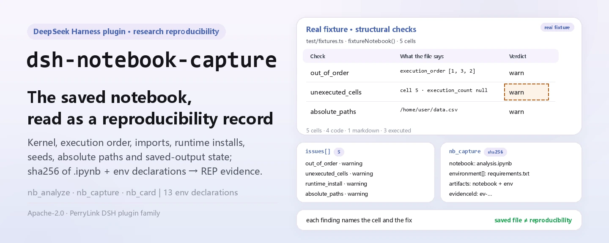
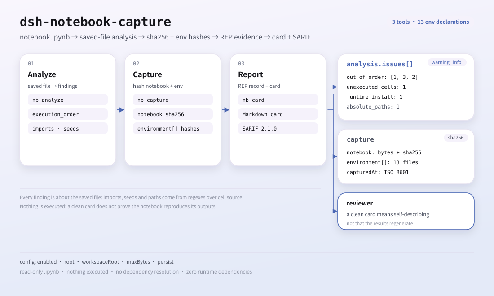
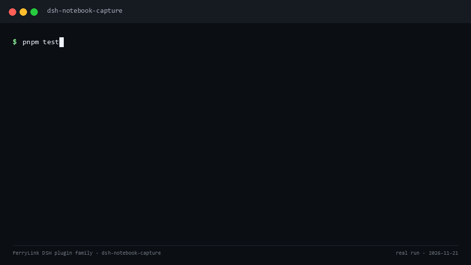

<div align="center">

<picture>
  <source media="(prefers-color-scheme: dark)" srcset="docs/assets/dsh-notebook-capture-hero-en-dark.webp">
  
</picture>

# dsh-notebook-capture

**Un notebook que se ejecuta en tu máquina todavía no es reproducible. Captura lo que el archivo guardado dice realmente.**

*Lee el JSON de `.ipynb` sin ejecutarlo: kernel, orden de ejecución, imports, instalaciones en tiempo de ejecución, semillas, rutas absolutas, estado de las salidas y hashes del notebook y de sus declaraciones de entorno — como evidencia REP y tarjeta Markdown.*

[English](README.md) · [简体中文](README-zh.md) · [Español](README-es.md) · [Português](README-pt.md) · [हिन्दी](README-hi.md)

[](LICENSE)
[]()

</div>

---

## Qué hace

- **`nb_analyze`** — analiza el notebook y reporta: kernel/lenguaje/versión, celdas de código frente a markdown, índices de ejecución (`out-of-order` y `never run`), imports (Python y R), instalaciones en tiempo de ejecución (`!pip install`, `%conda install`, `install.packages`), literales de semilla, rutas absolutas y si se guardaron las salidas.
- **`nb_capture`** — calcula el hash del notebook y de cada declaración de entorno que lo acompaña (`requirements.txt`, `environment.yml`, `pyproject.toml`, `renv.lock`, `Pipfile`, `Dockerfile`, …), guarda el notebook como evidencia REP inmutable y escribe un registro cuyos artefactos son los hashes del notebook y del entorno.
- **`nb_card`** — tarjeta Markdown + SARIF 2.1.0.


<picture>
  <source media="(prefers-color-scheme: dark)" srcset="docs/assets/dsh-notebook-capture-flow-v5-dark.svg">
  
</picture>

*Estructura: analizar → capturar → reportar; `analysis.issues[]` y `capture` son las dos salidas, y `nb_card` las renderiza como Markdown y SARIF 2.1.0. Las etiquetas dentro del diagrama son los nombres reales de herramientas y campos, así que la misma imagen sirve para los cinco idiomas.*

## Qué no hace

- **Sin ejecución.** No se ejecuta nada; la tarjeta habla del archivo guardado.
- **Sin garantía de reproducibilidad.** Una tarjeta limpia significa que el archivo se autodescribe, no que los resultados puedan regenerarse.
- **Sin resolución de dependencias.** Registra archivos de entorno; no comprueba que estén completos ni que sean instalables.
- **Sin detección de estado oculto.** La memoria del kernel de la que dependía una celda pero que nunca quedó registrada es invisible aquí.
- **Sin conversión a HTML/`.py`.** Solo `.ipynb`; usa `jupyter nbconvert` primero si hace falta.

## Comprobaciones estructurales

| Código | Gravedad | Significado |
|---|---|---|
| `out_of_order` | warning | los índices de ejecución no son crecientes |
| `unexecuted_cells` | warning | celdas de código sin índice de ejecución |
| `runtime_install` | warning | paquetes instalados dentro del notebook |
| `no_seed` | warning | hay celdas de código pero ningún literal de semilla |
| `absolute_paths` | warning | literales `/home/…`, `/Users/…`, `C:\…` |
| `outputs_missing` | info | ninguna celda lleva salidas guardadas |
| `no_kernel` | warning | los metadatos no tienen kernel/lenguaje |
| `no_imports` | info | no se encontró ninguna sentencia import |
| falta la declaración de entorno | warning | se reporta en los warnings de la captura |

## Herramientas

### `nb_analyze`

`{ text? | path? }` → `{ ok, analysis }`.

### `nb_capture`

`{ path, persist? }` → `{ ok, capture, evidenceId?, recordPath? }`.

### `nb_card`

`{ capture }` → `{ ok, markdown, sarif }`.

### Códigos de error

`INVALID_INPUT` · `NOT_FOUND` · `PATH_ESCAPE` · `NOT_A_FILE` · `TOO_LARGE` · `NOT_NOTEBOOK` · `INVALID_JSON` · `STORE_ERROR`

## Compatibilidad e instalación

| | |
|---|---|
| DeepSeek Harness | **`dsh-v0.2.2-rc.4`** (verificado 2026-11-18); peer `>=0.2.1-0 <0.3.0 \|\| >=0.2.2-0 <0.3.0` |
| Node | `^22.19.0 \|\| >=24.9.0` (probado en `24.22.1`), solo ESM |
| Peers | `@perrylink/dsh-research-core ^0.1.0`, `@deepseek-ai/cordis ^4.0.5-alpha.1`, `@deepseek-ai/dsh-tools`, `@deepseek-ai/schemastery ^3.18.5-alpha.1` |
| Dependencias en tiempo de ejecución | **cero** |

```sh
dsh plugin --profile <name> add @perrylink/dsh-research-core dsh-notebook-capture
dsh --profile <name> --dump-config | grep dsh-notebook-capture
```

## Configuración

| Clave | Valor por defecto | Significado |
|---|---|---|
| `enabled` | `true` | `false` no monta nada |
| `root` | `.notebook-capture` | raíz de almacenamiento y registros |
| `workspaceRoot` | `process.cwd()` | las rutas de notebook deben resolver dentro de ella |
| `maxBytes` | `10485760` | tope del archivo o del texto del notebook (falla, nunca trunca) |
| `persist` | `true` | guarda el notebook como evidencia REP + registro |

## Límites de seguridad

- Solo lectura sobre el notebook; escribe únicamente bajo `root`.
- Contención mediante `realpath`; se rechazan los escapes por enlace simbólico.
- El tope de tamaño falla en voz alta; el JSON malformado se rechaza con un código estable.
- El JSON del notebook se trata como datos; el código de las celdas nunca se ejecuta.

## Evaluación



*Animado: la salida real de `pnpm test` el 2026-11-21 (4 archivos de prueba, 17 pruebas). El plugin no tiene CLI, así que su propia suite es la ejecución — parsing, detección del orden de ejecución, captura con registro REP y la tarjeta.*


**16 pruebas**: unión de arrays de source, rechazo de JSON inválido/no-notebook/celda malformada, conteo de celdas, detección de orden, celdas nunca ejecutadas, imports/instalaciones/semillas/rutas absolutas (una finding de semilla por llamada), metadatos de kernel, captura con hash de entorno + registro REP válido (artefactos de notebook + entorno), análisis desde texto y desde archivo, topes de tamaño de archivo y texto, rechazo de traversal/enlace simbólico/inválido/sobredimensionado, esquemas de herramientas, analyze→capture→card de extremo a extremo, rechazo de captura malformada, ramas de fallo, contrato de plugin, contrato de paquete. El fixture sintético del notebook vive en `test/fixtures.ts`, así que importarlo no vuelve a registrar las pruebas de otra suite.

No se declara ningún benchmark: son comprobaciones estructurales sobre un formato de archivo, fijadas por fixtures; no existe un corpus etiquetado de resultados de reproducibilidad.

## Limitaciones conocidas (v0.1)

- La detección de imports/semillas/rutas se basa en regex sobre el código de las celdas; formas de código poco habituales pueden pasar desapercibidas.
- Los archivos de entorno solo se buscan junto al notebook (no en la raíz del repositorio).
- El orden de ejecución usa el `execution_count` guardado; un notebook con los contadores borrados parece "nunca ejecutado".
- La tarjeta no puede saber si una figura provino realmente del código guardado.

## Licencia

Apache-2.0. Sin código de terceros en tiempo de ejecución.
