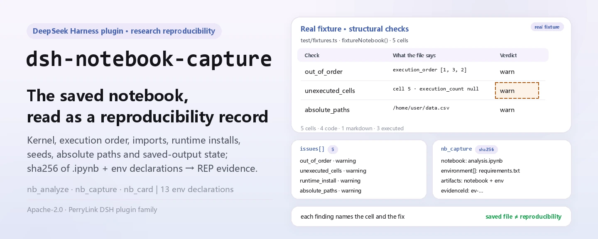
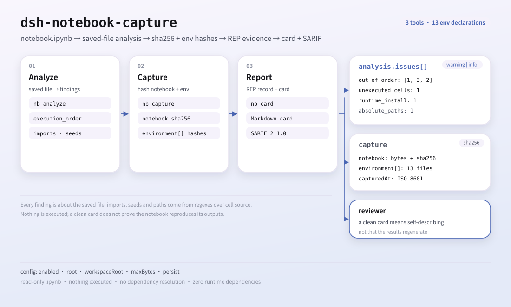
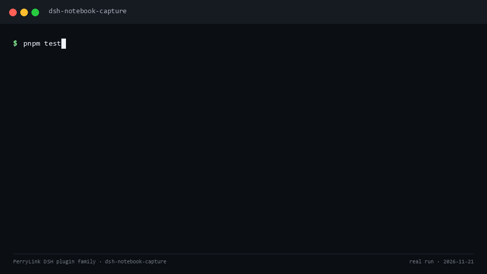

<div align="center">

<picture>
  <source media="(prefers-color-scheme: dark)" srcset="docs/assets/dsh-notebook-capture-hero-en-dark.webp">
  
</picture>

# dsh-notebook-capture

**आपकी मशीन पर चलने वाला notebook अभी reproducible नहीं है। जो सहेजी गई फ़ाइल वास्तव में कहती है, उसी को capture करें।**

*`.ipynb` JSON को बिना चलाए पढ़ता है: kernel, execution order, imports, runtime installs, seeds, absolute paths, output state, और notebook व उसकी environment declarations के hashes — REP evidence और Markdown card के रूप में।*

[English](README.md) · [简体中文](README-zh.md) · [Español](README-es.md) · [Português](README-pt.md) · [हिन्दी](README-hi.md)

[](LICENSE)
[]()

</div>

---

## यह क्या करता है

- **`nb_analyze`** — notebook को parse करके बताता है: kernel/भाषा/version, code बनाम markdown cells, execution counts (`out-of-order` और `never run`), imports (Python और R), runtime installs (`!pip install`, `%conda install`, `install.packages`), seed literals, absolute paths, और क्या outputs सहेजे गए थे।
- **`nb_capture`** — notebook और उसके पास की हर environment declaration (`requirements.txt`, `environment.yml`, `pyproject.toml`, `renv.lock`, `Pipfile`, `Dockerfile`, …) का hash निकालता है, notebook को अपरिवर्तनीय REP evidence के रूप में रखता है, और एक record लिखता है जिसके artifacts notebook और environment के hashes हैं।
- **`nb_card`** — Markdown card + SARIF 2.1.0.


<picture>
  <source media="(prefers-color-scheme: dark)" srcset="docs/assets/dsh-notebook-capture-flow-v5-dark.svg">
  
</picture>

*संरचना: analyze → capture → report; `analysis.issues[]` और `capture` दो outputs हैं, और `nb_card` उन्हें Markdown व SARIF 2.1.0 के रूप में render करता है। आरेख के भीतर केवल असली tool और field नाम हैं, इसलिए एक ही चित्र पाँचों भाषाओं के लिए है।*

## यह क्या नहीं करता

- **कोई execution नहीं।** कुछ भी नहीं चलाया जाता; card सहेजी गई फ़ाइल के बारे में है।
- **reproducibility की गारंटी नहीं।** साफ़ card का अर्थ है कि फ़ाइल खुद को वर्णित करती है, यह नहीं कि परिणाम दोबारा बनाए जा सकते हैं।
- **dependency resolution नहीं।** environment फ़ाइलें दर्ज करता है; यह नहीं जाँचता कि वे पूरी या installable हैं।
- **hidden-state detection नहीं।** वह kernel memory, जिस पर कोई cell निर्भर था पर जो कभी दर्ज नहीं हुई, यहाँ अदृश्य है।
- **HTML/`.py` conversion नहीं।** केवल `.ipynb`; ज़रूरत हो तो पहले `jupyter nbconvert` चलाएँ।

## संरचनात्मक जाँचें

| कोड | गंभीरता | अर्थ |
|---|---|---|
| `out_of_order` | warning | execution counts बढ़ते क्रम में नहीं हैं |
| `unexecuted_cells` | warning | ऐसी code cells जिनका execution count नहीं है |
| `runtime_install` | warning | notebook के अंदर install किए गए packages |
| `no_seed` | warning | code cells हैं पर कोई seed literal नहीं |
| `absolute_paths` | warning | `/home/…`, `/Users/…`, `C:\…` literals |
| `outputs_missing` | info | किसी cell में सहेजा गया output नहीं है |
| `no_kernel` | warning | metadata में kernel/भाषा नहीं है |
| `no_imports` | info | कोई import statement नहीं मिला |
| environment declaration अनुपस्थित | warning | capture के warnings में बताया जाता है |

## टूल्स

### `nb_analyze`

`{ text? | path? }` → `{ ok, analysis }`.

### `nb_capture`

`{ path, persist? }` → `{ ok, capture, evidenceId?, recordPath? }`.

### `nb_card`

`{ capture }` → `{ ok, markdown, sarif }`.

### त्रुटि कोड

`INVALID_INPUT` · `NOT_FOUND` · `PATH_ESCAPE` · `NOT_A_FILE` · `TOO_LARGE` · `NOT_NOTEBOOK` · `INVALID_JSON` · `STORE_ERROR`

## अनुकूलता और इंस्टॉल

| | |
|---|---|
| DeepSeek Harness | **`dsh-v0.2.2-rc.4`** (2026-11-18 को सत्यापित); peer `>=0.2.1-0 <0.3.0 \|\| >=0.2.2-0 <0.3.0` |
| Node | `^22.19.0 \|\| >=24.9.0` (`24.22.1` पर परीक्षित), केवल ESM |
| Peers | `@perrylink/dsh-research-core ^0.1.0`, `@deepseek-ai/cordis ^4.0.5-alpha.1`, `@deepseek-ai/dsh-tools`, `@deepseek-ai/schemastery ^3.18.5-alpha.1` |
| runtime dependencies | **शून्य** |

```sh
dsh plugin --profile <name> add @perrylink/dsh-research-core dsh-notebook-capture
dsh --profile <name> --dump-config | grep dsh-notebook-capture
```

## कॉन्फ़िगरेशन

| Key | डिफ़ॉल्ट | अर्थ |
|---|---|---|
| `enabled` | `true` | `false` होने पर कुछ भी mount नहीं होता |
| `root` | `.notebook-capture` | store और records की जड़ |
| `workspaceRoot` | `process.cwd()` | notebook paths इसी के भीतर resolve होने चाहिए |
| `maxBytes` | `10485760` | notebook फ़ाइल या text की सीमा (सीमा टूटे तो विफल, कभी truncate नहीं) |
| `persist` | `true` | notebook को REP evidence + record के रूप में सहेजता है |

## सुरक्षा सीमाएँ

- notebook पर केवल पढ़ता है; लिखता केवल `root` के नीचे है।
- `realpath` containment; symlink से बाहर निकलना अस्वीकार होता है।
- आकार की सीमा टूटने पर स्पष्ट विफलता; खराब JSON स्थिर कोड के साथ अस्वीकार होता है।
- notebook JSON को data माना जाता है; cells का source कभी नहीं चलाया जाता।

## मूल्यांकन



*एनिमेटेड: 2026-11-21 की असली `pnpm test` output (4 टेस्ट फ़ाइलें, 17 टेस्ट)। इस plugin का CLI नहीं है, इसलिए उसका अपना suite ही वह रन है — parsing, execution-order detection, REP record के साथ capture, और card।*


**17 टेस्ट**: source arrays का जोड़, अमान्य JSON/गैर-notebook/खराब cell का अस्वीकार, cell गिनती, out-of-order पहचान, कभी न चली cells, imports/installs/seeds/absolute paths (प्रति कॉल एक seed finding), kernel metadata, environment hash + वैध REP record के साथ capture (notebook + env artifacts), text और file दोनों से analyze, file/text आकार सीमाएँ, traversal/symlink/अमान्य/अति-बड़े का अस्वीकार, tool schemas, analyze→capture→card end-to-end, खराब capture का अस्वीकार, failure शाखाएँ, plugin contract, package contract। कृत्रिम notebook fixture `test/fixtures.ts` में रहता है, इसलिए उसे import करने से किसी दूसरे suite के टेस्ट दोबारा पंजीकृत नहीं होते।

कोई benchmark दावा नहीं किया गया: ये एक फ़ाइल फ़ॉर्मैट पर संरचनात्मक जाँचें हैं, fixtures से स्थिर; reproducibility परिणामों का कोई labelled corpus नहीं है।

## ज्ञात सीमाएँ (v0.1)

- import/seed/path पहचान cell source पर regex आधारित है; असामान्य code आकार छूट सकते हैं।
- environment फ़ाइलें केवल notebook के पास खोजी जाती हैं (repository root में नहीं)।
- execution order सहेजे गए `execution_count` का उपयोग करता है; counts मिटाए गए notebook "कभी नहीं चला" जैसा दिखता है।
- card यह नहीं जान सकता कि कोई figure सचमुच सहेजे गए code से आया था या नहीं।

## लाइसेंस

Apache-2.0. runtime में कोई तृतीय-पक्ष कोड नहीं।
