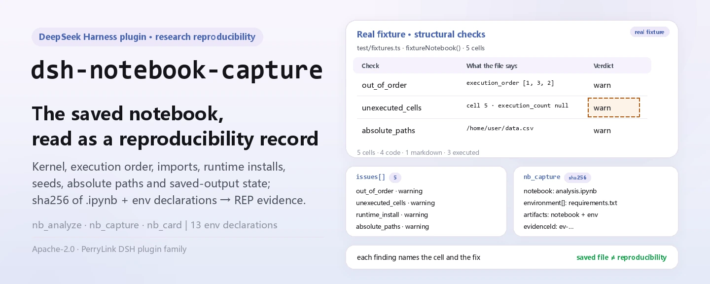
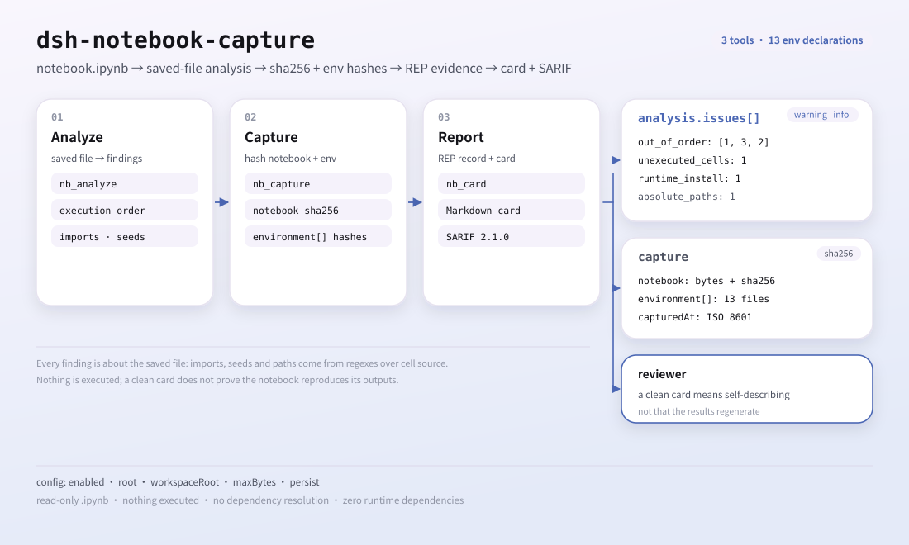
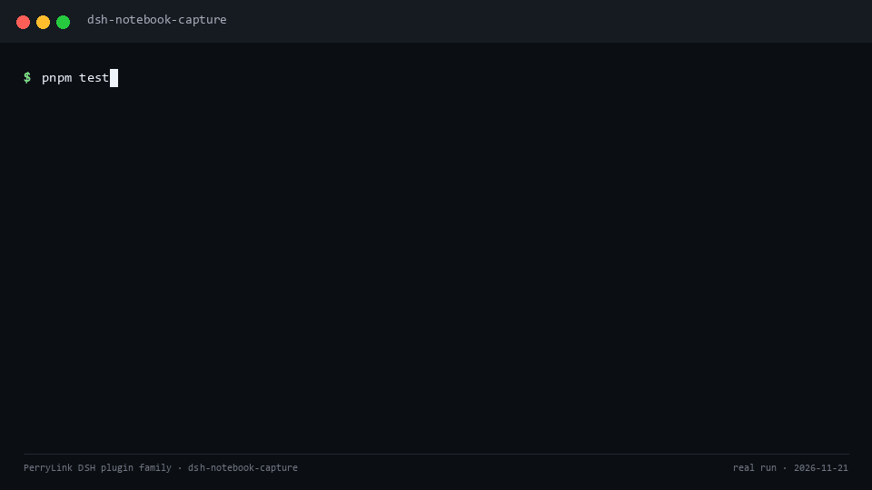

<div align="center">

<picture>
  <source media="(prefers-color-scheme: dark)" srcset="docs/assets/dsh-notebook-capture-hero-en-dark.webp">
  
</picture>

# dsh-notebook-capture

**Um notebook que roda na sua máquina ainda não é reproduzível. Capture o que o arquivo salvo realmente diz.**

*Lê o JSON do `.ipynb` sem executá-lo: kernel, ordem de execução, imports, instalações em tempo de execução, sementes, caminhos absolutos, estado das saídas e hashes do notebook e das suas declarações de ambiente — como evidência REP e cartão Markdown.*

[English](README.md) · [简体中文](README-zh.md) · [Español](README-es.md) · [Português](README-pt.md) · [हिन्दी](README-hi.md)

[](LICENSE)
[]()

</div>

---

## O que ele faz

- **`nb_analyze`** — analisa o notebook e reporta: kernel/linguagem/versão, células de código versus markdown, contagens de execução (`out-of-order` e `never run`), imports (Python e R), instalações em tempo de execução (`!pip install`, `%conda install`, `install.packages`), literais de semente, caminhos absolutos e se as saídas foram salvas.
- **`nb_capture`** — calcula o hash do notebook e de cada declaração de ambiente ao lado dele (`requirements.txt`, `environment.yml`, `pyproject.toml`, `renv.lock`, `Pipfile`, `Dockerfile`, …), guarda o notebook como evidência REP imutável e grava um registro cujos artefatos são os hashes do notebook e do ambiente.
- **`nb_card`** — cartão Markdown + SARIF 2.1.0.


<picture>
  <source media="(prefers-color-scheme: dark)" srcset="docs/assets/dsh-notebook-capture-flow-v5-dark.svg">
  
</picture>

*Estrutura: analisar → capturar → reportar; `analysis.issues[]` e `capture` são as duas saídas, e `nb_card` as renderiza como Markdown e SARIF 2.1.0. Os rótulos dentro do diagrama são os nomes reais de ferramentas e campos, então a mesma imagem serve aos cinco idiomas.*

## O que ele não faz

- **Sem execução.** Nada é executado; o cartão fala do arquivo salvo.
- **Sem garantia de reprodutibilidade.** Um cartão limpo significa que o arquivo se autodescreve, não que os resultados possam ser regenerados.
- **Sem resolução de dependências.** Registra arquivos de ambiente; não verifica se estão completos ou se são instaláveis.
- **Sem detecção de estado oculto.** A memória do kernel da qual uma célula dependia mas que nunca foi registrada é invisível aqui.
- **Sem conversão para HTML/`.py`.** Apenas `.ipynb`; use `jupyter nbconvert` antes se precisar.

## Checagens estruturais

| Código | Severidade | Significado |
|---|---|---|
| `out_of_order` | warning | as contagens de execução não são crescentes |
| `unexecuted_cells` | warning | células de código sem contagem de execução |
| `runtime_install` | warning | pacotes instalados dentro do notebook |
| `no_seed` | warning | há células de código mas nenhum literal de semente |
| `absolute_paths` | warning | literais `/home/…`, `/Users/…`, `C:\…` |
| `outputs_missing` | info | nenhuma célula carrega saída salva |
| `no_kernel` | warning | os metadados não têm kernel/linguagem |
| `no_imports` | info | nenhuma instrução import foi encontrada |
| declaração de ambiente ausente | warning | reportada nos warnings da captura |

## Ferramentas

### `nb_analyze`

`{ text? | path? }` → `{ ok, analysis }`.

### `nb_capture`

`{ path, persist? }` → `{ ok, capture, evidenceId?, recordPath? }`.

### `nb_card`

`{ capture }` → `{ ok, markdown, sarif }`.

### Códigos de erro

`INVALID_INPUT` · `NOT_FOUND` · `PATH_ESCAPE` · `NOT_A_FILE` · `TOO_LARGE` · `NOT_NOTEBOOK` · `INVALID_JSON` · `STORE_ERROR`

## Compatibilidade e instalação

| | |
|---|---|
| DeepSeek Harness | **`dsh-v0.2.2-rc.4`** (verificado em 2026-11-18); peer `>=0.2.1-0 <0.3.0 \|\| >=0.2.2-0 <0.3.0` |
| Node | `^22.19.0 \|\| >=24.9.0` (testado em `24.22.1`), apenas ESM |
| Peers | `@perrylink/dsh-research-core ^0.1.0`, `@deepseek-ai/cordis ^4.0.5-alpha.1`, `@deepseek-ai/dsh-tools`, `@deepseek-ai/schemastery ^3.18.5-alpha.1` |
| Dependências em tempo de execução | **zero** |

```sh
dsh plugin --profile <name> add @perrylink/dsh-research-core dsh-notebook-capture
dsh --profile <name> --dump-config | grep dsh-notebook-capture
```

## Configuração

| Chave | Padrão | Significado |
|---|---|---|
| `enabled` | `true` | `false` não monta nada |
| `root` | `.notebook-capture` | raiz de armazenamento e registros |
| `workspaceRoot` | `process.cwd()` | os caminhos de notebook devem resolver dentro dela |
| `maxBytes` | `10485760` | limite do arquivo ou do texto do notebook (falha, nunca trunca) |
| `persist` | `true` | guarda o notebook como evidência REP + registro |

## Limites de segurança

- Somente leitura no notebook; escreve apenas sob `root`.
- Contenção por `realpath`; escapes por symlink são rejeitados.
- O limite de tamanho falha em voz alta; JSON malformado é recusado com um código estável.
- O JSON do notebook é tratado como dado; o código das células nunca é executado.

## Avaliação



*Animado: a saída real de `pnpm test` em 2026-11-21 (4 arquivos de teste, 17 testes). O plugin não tem CLI, então a própria suíte é a execução — parsing, detecção de ordem de execução, captura com registro REP e o cartão.*


**16 testes**: junção de arrays de source, rejeição de JSON inválido/não-notebook/célula malformada, contagem de células, detecção de ordem, células nunca executadas, imports/instalações/sementes/caminhos absolutos (uma finding de semente por chamada), metadados de kernel, captura com hash de ambiente + registro REP válido (artefatos de notebook + ambiente), análise a partir de texto e de arquivo, limites de tamanho de arquivo e texto, rejeição de traversal/symlink/inválido/grande demais, schemas de ferramentas, analyze→capture→card de ponta a ponta, rejeição de captura malformada, ramos de falha, contrato de plugin, contrato de pacote. O fixture sintético do notebook fica em `test/fixtures.ts`, então importá-lo não registra novamente os testes de outra suíte.

Não é reivindicado nenhum benchmark: são checagens estruturais sobre um formato de arquivo, fixadas por fixtures; não existe um corpus rotulado de resultados de reprodutibilidade.

## Limitações conhecidas (v0.1)

- A detecção de imports/sementes/caminhos é baseada em regex sobre o código das células; formas de código incomuns podem passar despercebidas.
- Arquivos de ambiente são procurados apenas ao lado do notebook (não na raiz do repositório).
- A ordem de execução usa o `execution_count` salvo; um notebook com as contagens apagadas parece "nunca executado".
- O cartão não tem como saber se uma figura veio mesmo do código salvo.

## Licença

Apache-2.0. Sem código de terceiros em tempo de execução.
